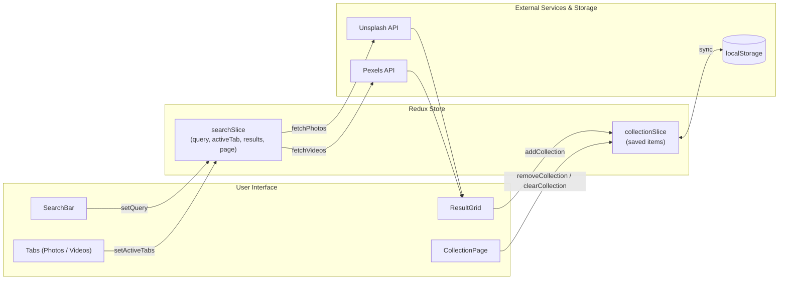

# MediaSearch 📌

> A Pinterest-inspired media discovery web application built with **React 19**, **Redux Toolkit**, and **Tailwind CSS**. Search high-resolution photos and videos from **Unsplash** and **Pexels**, and curate your personal collection saved persistently in local storage.

---

## 🌟 Features

- **🔍 Multi-Platform Media Discovery**:
  - Search high-resolution **Photos** powered by the **Unsplash API**.
  - Search high-definition **Videos** powered by the **Pexels API** with inline auto-playback.
- **📑 Tab-Based Filtering**: Seamlessly toggle between Photos and Videos with dedicated category tabs.
- **📌 Personal Collection (Pinterest-Style)**:
  - Save your favorite photos and videos with a single click.
  - Media cards visually indicate when an item is already saved.
  - Persistent storage backed by **Redux Toolkit** and `localStorage` — your collection remains safe across browser refreshes.
- **⚡ Smooth & Responsive UX**:
  - Skeleton loading placeholders while media loads.
  - Infinite / paginated **Load More** functionality.
  - Elegant dark mode UI crafted with **Tailwind CSS v4**.
- **🔔 Interactive Notifications & Dialogs**:
  - Non-intrusive toast notifications with **React-Toastify** on save and remove actions.
  - Confirmation modal prompts via **SweetAlert2** before deleting single items or wiping the entire collection.

---

## 🛠️ Tech Stack

| Category | Technology |
| :--- | :--- |
| **Framework** | [React 19](https://react.dev/) |
| **Build Tool** | [Vite 8](https://vitejs.dev/) |
| **State Management** | [Redux Toolkit](https://redux-toolkit.js.org/) & [React-Redux](https://react-redux.js.org/) |
| **Styling** | [Tailwind CSS v4](https://tailwindcss.com/) |
| **Routing** | [React Router v7](https://reactrouter.com/) |
| **HTTP Client** | [Axios](https://axios-http.com/) |
| **UI Notifications** | [React-Toastify](https://fkhadra.github.io/react-toastify/) & [SweetAlert2](https://sweetalert2.github.io/) |
| **Media APIs** | [Unsplash API](https://unsplash.com/developers) & [Pexels API](https://www.pexels.com/api/) |

---

## 📁 Project Structure

```text
├── public/                 # Static assets
├── src/
│   ├── api/
│   │   └── mediaApi.js     # Axios API service for Unsplash & Pexels endpoints
│   ├── components/
│   │   ├── CollectionCard.jsx # Card for items saved in collection
│   │   ├── Navbar.jsx         # Header navigation bar
│   │   ├── ResultCard.jsx     # Media item card with save/view actions
│   │   ├── ResultGrid.jsx     # Media results grid with load more & error handling
│   │   ├── SearchBar.jsx      # Search input form
│   │   ├── SkeletonCard.jsx   # Loading skeleton placeholder
│   │   └── Tabs.jsx           # Photos / Videos switcher tabs
│   ├── pages/
│   │   ├── HomePage.jsx       # Search & discovery page
│   │   └── CollectionPage.jsx # Saved collection view with clear collection option
│   ├── redux/
│   │   ├── features/
│   │   │   ├── collectionSlice.js # Collection state + localStorage synchronization
│   │   │   └── searchSlice.js     # Search query, results, active tab, & pagination state
│   │   └── store.js               # Redux store configuration
│   ├── App.jsx             # Main routing and toast setup
│   ├── index.css           # Tailwind CSS imports and theme variables
│   └── main.jsx            # Application entry point with Redux Provider
├── .env.example            # Environment variables template
├── eslint.config.js        # ESLint configuration
├── index.html              # HTML shell
├── package.json            # Project dependencies and npm scripts
└── vite.config.js          # Vite configuration
```

---

## 🚀 Getting Started

### Prerequisites

Ensure you have the following installed:
- [Node.js](https://nodejs.org/) (version `18.x` or higher recommended)
- [npm](https://www.npmjs.com/) or [yarn](https://yarnpkg.com/) / [pnpm](https://pnpm.io/)

### 1. Clone & Install

```bash
# Clone the repository
git clone <your-repository-url>

# Navigate into the project directory
cd project

# Install project dependencies
npm install
```

### 2. Configure Environment Variables

Create a `.env` file in the root directory by copying `.env.example`:

```bash
cp .env.example .env
```

Open `.env` and provide your API keys:

```env
# Unsplash Access Key (Required for photos)
VITE_UNSPLASH_KEY=your_unsplash_access_key_here

# Pexels API Key (Required for videos)
VITE_PEXELS_KEY=your_pexels_api_key_here
```

#### How to get API keys:
1. **Unsplash API Key**:
   - Go to [Unsplash Developers](https://unsplash.com/developers).
   - Register or sign in, then click **"Your Apps"** > **"New Application"**.
   - Copy your **Access Key** and paste it into `VITE_UNSPLASH_KEY`.
2. **Pexels API Key**:
   - Go to [Pexels API](https://www.pexels.com/api/).
   - Sign up or log in, then request an API key.
   - Copy your generated API key and paste it into `VITE_PEXELS_KEY`.

### 3. Start the Development Server

```bash
npm run dev
```

Open your browser and navigate to `http://localhost:5173`.

---

## 📜 Available Scripts

| Script | Command | Description |
| :--- | :--- | :--- |
| **Development** | `npm run dev` | Starts Vite dev server with hot module replacement (HMR) |
| **Build** | `npm run build` | Compiles and bundles production-ready assets into `/dist` |
| **Preview** | `npm run preview` | Locally previews the production build |
| **Lint** | `npm run lint` | Runs ESLint to check for code quality and style issues |

---

## 🧠 State Management Workflow



---

## 🤝 Contributing

Contributions, issues, and feature requests are welcome! Feel free to open an issue or submit a pull request.

---

## 📄 License

This project is open-source and available under the [MIT License](LICENSE).
